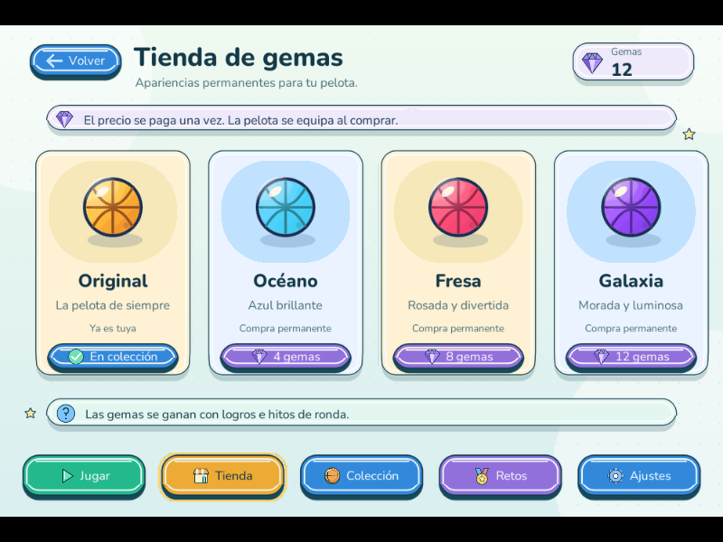
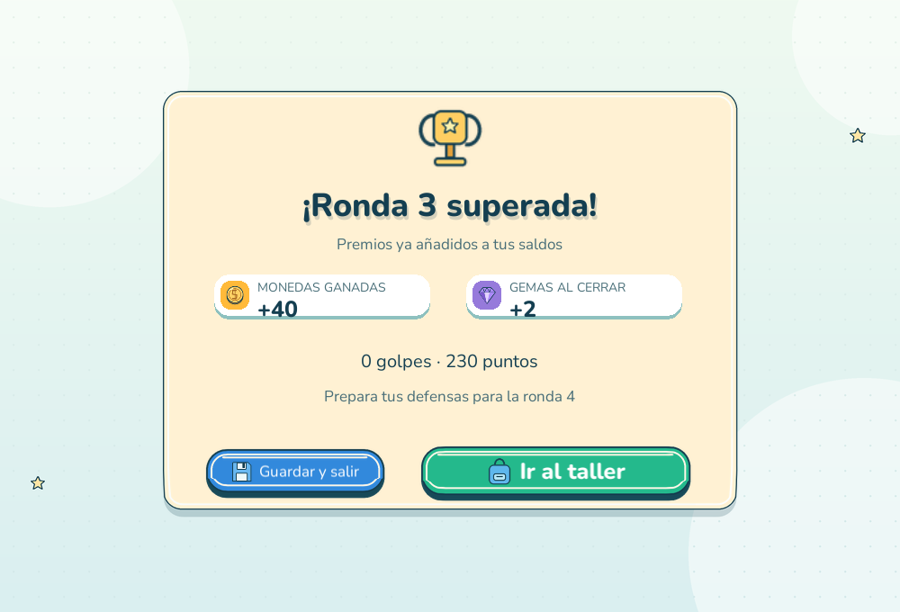
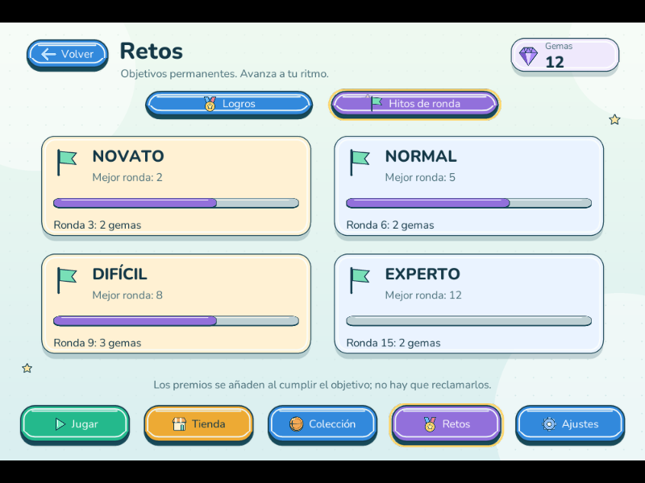

# Balller v8 — B2: tienda global, Retos y resumen de ronda

Base: `60c45493483d95fa976d0793c4ac9b338fc1725e` (B1). Rama `feature/v8-screens-b2`, revisión dirigida a `feature/v8-visual-foundation`.

## Flujos implementados

| Pantalla | Flujo y persistencia |
|---|---|
| Tienda de gemas | Las cuatro pelotas existentes; precio, saldo y compra permanente; confirmación/cancelación; compra equipa y guarda. Las poseídas llevan a Colección. Sin fondos se deshabilita comprar. Un breve bloqueo evita abrir otra compra por doble clic al cerrar la confirmación. |
| Colección | Distingue poseídas/bloqueadas/equipada. Equipa gratis las poseídas; las bloqueadas enlazan a Tienda. Muestra el resultado de guardado y revierte el cambio en memoria si guardar falla. |
| Retos: Logros | Cuatro logros permanentes existentes, progreso real, premio automático de dos gemas y estado completado. No exige reclamación adicional. |
| Retos: Hitos | Mejor ronda y próximo hito por cada dificultad histórica, recompensa visible de dos/tres gemas y progreso desde el hito previo. Solo consulta datos: abrir la pestaña no entrega gemas. |
| Resultado de ronda | Se abre al terminar una ronda jugada. Copia los premios ya calculados/pagados, puntuación y golpes; lleva al taller o guarda y sale. Entrar primero al taller con Enter evita iniciar la próxima ronda por accidente. |
| Navegación | Cinco destinos: Jugar, Tienda, Colección, Retos, Ajustes. Barra PNG común en esas pantallas, con destino activo destacado. El taller de monedas queda dentro de la partida. |

Se mantienen las cuatro pelotas y los precios anteriores. La Tienda usa gemas globales; el Taller usa monedas de la ranura. No se introducen monedas, dificultades, capítulos, cosméticos adicionales ni misiones diarias en este hito.

## Presentación y arquitectura

- `src/screens/hub.lua`: Tienda, Colección, Retos, confirmación y navegación compartida.
- `src/presentation/round_results.lua`: copia visual del resultado, sin funciones de pago.
- `assets/ui/meters.png`: barras PNG para logros, hitos, objetivo y recarga del pulso; carga única con fallback y segmentos horizontales.
- Se conserva el estado guardado `shop`. El resumen es transitorio: al cargar se vuelve al taller, sin simular otra victoria ni reconstruir gemas no guardadas. Se limpia el premio transitorio de gemas al cargar para evitar mostrar el de otra ranura.
- `P.unlock` restaura saldo, posesión y equipamiento si falla el respaldo o la escritura del perfil. `P.save` deja de continuar si no puede preservar el respaldo.
- El resumen muestra las monedas realmente acreditadas al aplicar el tope y las gemas obtenidas al cierre, incluidos logros de rondas. Las gemas recibidas por golpes/estrellas durante la ronda ya están en el perfil y no se vuelven a anunciar como premio de cierre.
- Sin migración de formato: lectores v4–v7 y perfil original siguen vigentes; los sprites históricos no se reemplazan.

## Comprobaciones locales

Todas las suites previas pasan, incluidas compatibilidad de tres ranuras, economía y 132 escenarios de velocidad. Nuevas pruebas:

- `b2_flow.lua`: navegación, confirmación/cancelación, bloqueo del fondo modal, doble clic, compra/equipamiento, hitos, resumen sin repetición de premios, reanudación y clics escalados.
- `b2_persistence.lua`: fallos simulados al escribir respaldo y perfil, reversión de compra/equipamiento, preservación del original y recarga de una compra válida.
- `ui_assets.lua`: también límites, llenado mínimo/máximo y fallback de las barras PNG.
- `check_ui_assets.py`: 37 PNG de UI, 32 iconos y fuentes/licencia.
- LÖVE 11.5 real en Linux, Mesa por software: `--ci-flow` ejecuta cancelar → comprar → leer perfil del disco → equipar → continuar partida → terminar ronda → leer ranura del disco → ver resultado → salir. Identidad aislada `balller_ci_flow_v8`.
- Capturas nativas en cinco resoluciones, con datos sintéticos para composición: 17 vistas × 5 = 85; incluyen Tienda sin fondos, compra modal, Colección con una pelota adicional equipada, Logros, Hitos y resultados.
- Parseo de todos los Lua, PNG, empaquetado y arranque nativo del .love. Capturas y paquete de desarrollo se comprueban además en GitHub Actions; consultar la ejecución asociada a la PR para el resultado remoto.

```bash
lua tests/b2_flow.lua
lua tests/b2_persistence.lua
love . --ci-flow
love . --visual-check
python3 tools/package_love.py --output Balller-v8-B2.love
love dist/Balller-v8-B2.love --ci-smoke
```

Las herramientas `--ci-flow` y `--visual-check` requieren el checkout fuente; el paquete jugable conserva `--ci-smoke`. Sus identidades de prueba son independientes de `balller`.

## Límites pendientes

La escritura final sigue siendo directa, con respaldo; no se certifican escrituras atómicas ni cortes de energía. La reversión probada corresponde a errores reportados por filesystem. Las transacciones entre perfil y ranura, las misiones diarias/semanales nuevas, la defensa frente a restauraciones manuales y las recompensas de capítulos pertenecen a las siguientes fases. La pantalla Retos presenta logros/hitos ya funcionales, sin anunciar esos sistemas futuros.

La fase visual aún requiere fondos de capítulo y pulido de cancha/HUD; después sigue completar la revisión de navegación, ranuras y tutorial. No se da por validado el balance, el audio ni la ejecución manual en Catalina/Windows. No se crea una publicación final.

## Capturas del juego ejecutado






