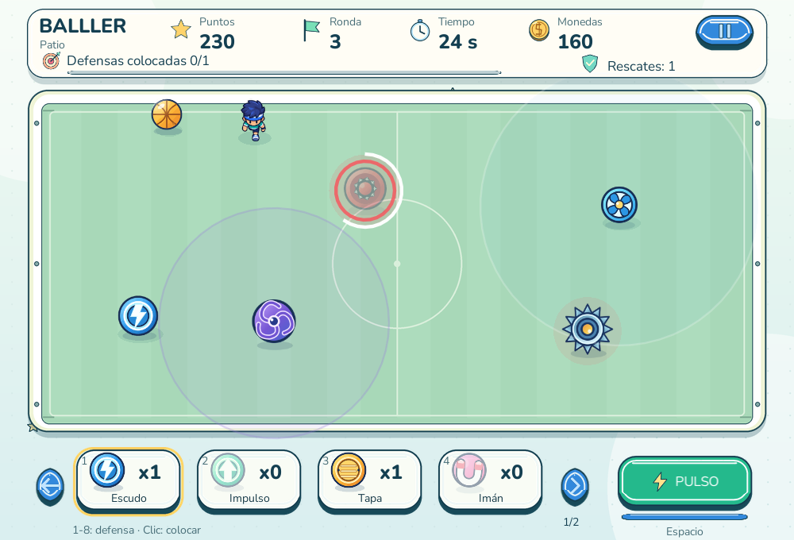
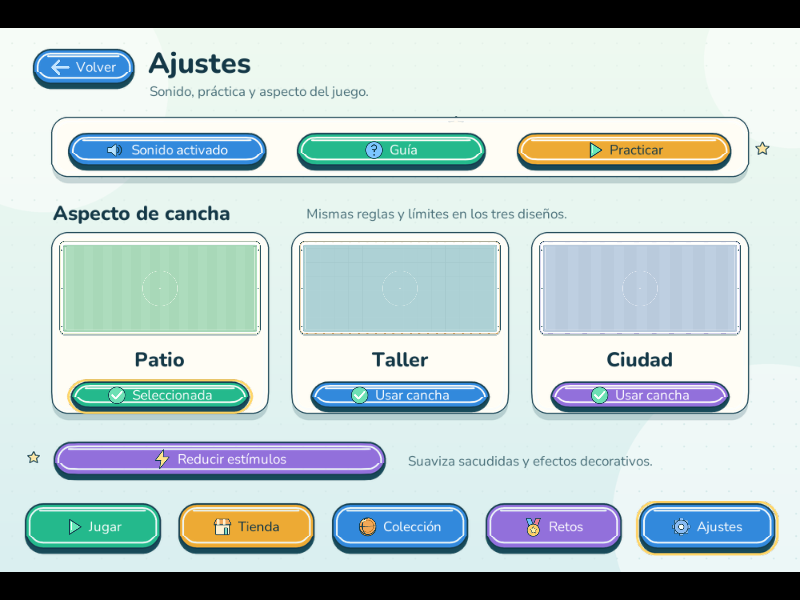
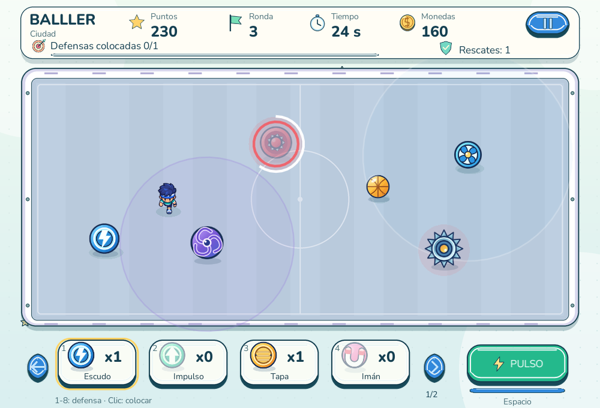

# Balller v8 — B3: canchas PNG, HUD despejado y ajustes visuales

Base: `77a219be368a4ed81277c7bf4ebf3c2a1fd00411` (B2). Rama `feature/v8-courts-hud-b3`, revisión dirigida a `feature/v8-screens-b2`.

## Implementado

| Elemento | Resultado |
|---|---|
| Tres canchas PNG | Patio, Taller y Ciudad, tamaño 932×440 y borde de 18 px. Se seleccionan desde Ajustes, con vista previa y estado seleccionado. Son aspectos, sin capítulos ni cambios de dificultad. |
| HUD fuera de la cancha | Objetivo y rescates pasan a la cabecera; avisos y ayudas quedan bajo el inventario. La pelota situada junto al borde superior se ve completa. Se mantienen las coordenadas físicas históricas. |
| Tutorial | La instrucción actual aparece en la cabecera con paso 1–4 y progreso, sin panel sobre la pelota. Se corrige el desfase de instrucciones al avanzar. El tiempo de práctica muestra “--”, porque no cuenta hacia atrás. |
| Inventario | Tarjetas PNG con selección destacada y tecla 1–8 visible. Cantidades, cambio de página y colocación usan las reglas anteriores. |
| Ajustes | Sonido, guía y práctica conservados; selección de cancha y Reducir estímulos con guardado inmediato y mensaje de error si falla. |
| Reducir estímulos | Suprime sacudidas, estelas, partículas/popups decorativos y algunos pulsos/balanceos; conserva movimiento, sprites direccionales, avisos, trayectoria de peligros y señales de protección. |
| Datos extremos | Números largos ajustan fuente; avisos largos se acortan en una sola línea conservando caracteres UTF-8 completos. |

## Compatibilidad y arquitectura

- `src/arena.lua`, colisiones, precios, dificultades, sprites anteriores y los formatos de ranura/perfil no se cambian.
- `data/arena_themes.lua` contiene identificadores estables y referencias visuales. El empaquetador ahora incluye `data/`.
- `src/presentation/preferences.lua` guarda únicamente el aspecto y el modo reducido en `balller_visual_v8.txt`, esquema `BALLLER_VISUAL_1`. No toca ranuras ni perfil. Datos ausentes/inválidos usan Patio y modo normal; una escritura fallida no cambia la preferencia en memoria.
- `src/presentation/hud_layout.lua` concentra las cajas principales que se comprueban fuera de la cancha.
- `src/screens/visual_settings.lua` usa las mismas superficies/iconos PNG y navegación que el resto del menú.
- Los recursos PNG cargados por la presentación (atlas, fondos y tres canchas) ocupan aproximadamente 11,45 MiB en RGBA sin comprimir, sin contar fuentes, sprites, buffers de pantalla ni uso real del motor. No es una medición de RAM total.
- Se reemplaza el azar de la sacudida al dibujar por oscilación determinista. Desactivar el efecto ya no consume una secuencia distinta del generador de peligros.
- El fallback de cancha deja de usar un recorte en coordenadas físicas: funciona también al escalar/centrar el dibujo.

## Validación local

Todas las suites anteriores pasan. Se añaden:

- `b3_preferences.lua`: tres identificadores, guardado/recarga, datos inválidos, fallo de escritura y separación de archivos de partida/perfil.
- `b3_hud.lua`: cajas del HUD sin intersección con la cancha, cuatro instrucciones de tutorial, texto largo/UTF-8, clics en Ajustes a cinco tamaños y escritura fallida. Compara el guardado completo de una simulación normal y otra reducida con la misma semilla, dibujando cada paso: movimiento y peligros coinciden.
- `check_ui_assets.py`: valida también CRC, dimensiones y descompresión de las tres canchas; total 40 PNG de UI/cancha, más los 21 sprites existentes comprobados por su prueba.
- LÖVE 11.5 real, Linux/Mesa/SDL offscreen: el circuito B2 completo se extiende con selección de Taller, activación del modo reducido, lectura del archivo real y reanudación de juego con rapidez constante.
- 125 capturas nativas: 25 vistas en 1000×680, 800×600, 1280×720, 1366×768 y 1920×1080. Incluyen cancha con amenazas/defensas, borde superior, números grandes, aviso largo, práctica, modo reducido y PNG de cancha ausente.
- Paquete `Balller-v8-B3.love`, comprobación ZIP y arranque nativo. GitHub Actions repite las suites, el circuito con archivos reales, las capturas y la ejecución del paquete; consultar el resultado de la PR.

Las capturas usan datos sintéticos para comprobar composición. Los ejemplos con amenazas colocadas no son una medición de justicia del generador; el tutorial capturado utiliza la práctica real sin peligros.

```bash
lua tests/b3_preferences.lua
lua tests/b3_hud.lua
python3 tests/check_ui_assets.py
love . --ci-flow
love . --visual-check
python3 tools/package_love.py --output Balller-v8-B3.love
love dist/Balller-v8-B3.love --ci-smoke
```

## Estado de las fases

Esta entrega completa los recursos de cancha y el pulido principal del HUD pendientes de B2. Los aspectos permiten revisar las identidades Patio/Taller/Ciudad antes de implementar capítulos. La revisión manual en Catalina/Windows, el balance y pruebas de rendimiento reales siguen pendientes.

La siguiente parte se centra en navegación y facilidad de uso de la fase C: gestión de ranuras, recuperación visible, Nueva/Continuar y tutorial completo. Capítulos, jefes, objetivos nuevos y defensas/peligros adicionales continúan en E; misiones nuevas en F y audio/mezcla en G. No se publica una versión final.

## Capturas reales






