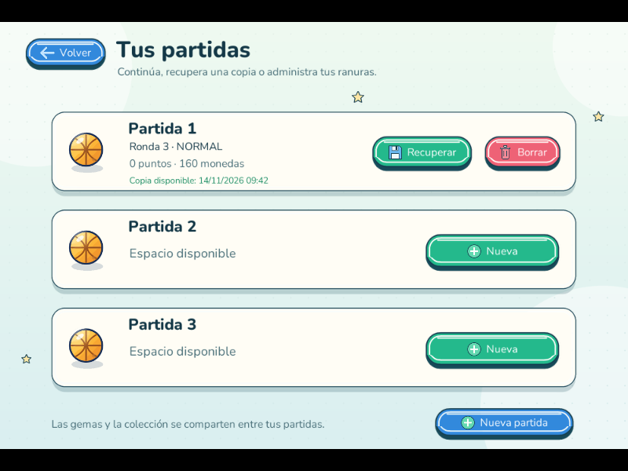
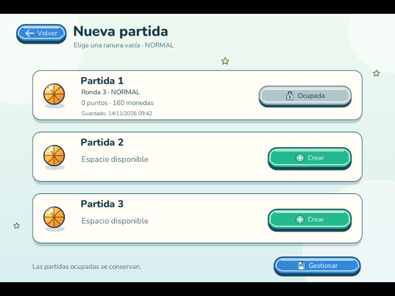
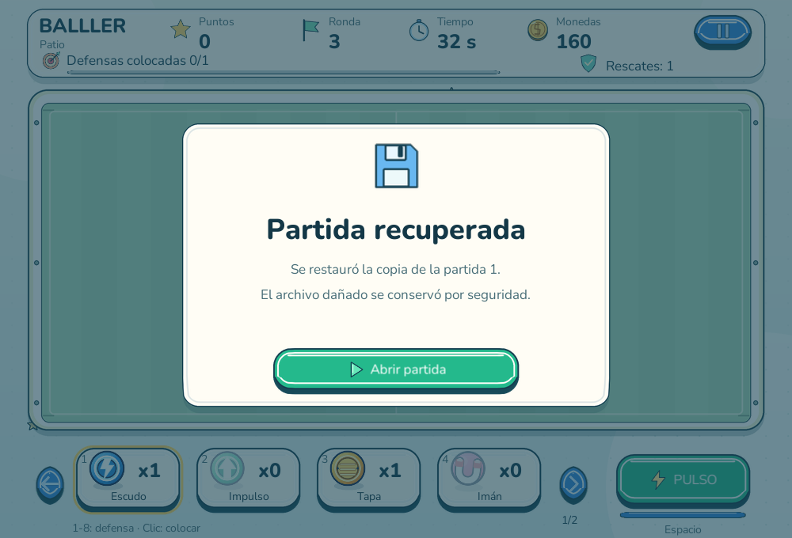

# Balller v8 — C1: Nueva/Continuar, ranuras y recuperación visible

Base: `3cb94361403cb2407c3aefd1c3d959e8cbec421b` (B3). Rama `feature/v8-run-flow-c1`, revisión dirigida a `feature/v8-courts-hud-b3`.

## Implementado

| Flujo | Comportamiento |
|---|---|
| Nueva desde inicio | Dificultad → ranura vacía → guardar estado inicial → Taller. Las ocupadas se muestran bloqueadas y se puede ir a Gestionar. No se continúa una partida histórica después de elegir otra dificultad. |
| Continuar | Muestra partidas válidas, copias recuperables, archivos dañados y espacios vacíos. Una ranura vacía abre la dificultad para crear en esa ranura concreta. |
| Sin ranuras ocupadas/libres | Continuar está deshabilitado si no hay archivos. Con las tres ocupadas, la acción principal y Enter llevan a Tus partidas; Nueva queda bloqueada en el gestor hasta liberar espacio. |
| Consultar ranuras | `inspectRun` y `slotInfo` son de solo lectura. Dibujar tarjetas ya no restaura ni reescribe archivos. Las tarjetas muestran pelota global equipada, dificultad, ronda, puntos, monedas y fecha del archivo/copia cuando el sistema la proporciona. |
| Recuperar | Valida la copia; conserva los bytes del principal dañado en un archivo diagnóstico; restaura y verifica la escritura. Muestra Partida recuperada y requiere cerrar el aviso antes de usar los controles. Una ronda cargada sigue en pausa. |
| Borrar | Confirmación explícita, fondo bloqueado, Cancelar/Escape. Si no puede borrar el principal, conserva el respaldo. Si falla el respaldo después de borrar el principal, informa del fallo y permite reintentar. No anuncia éxito mientras quedan archivos activos. |
| Crear con fallo de escritura | No entra al Taller ni suma una partida jugada; muestra error y permite volver a intentar. Se valida que la salida del codificador se pueda leer antes de sustituir un guardado. |

Los botones de una pantalla dejan de estar activos al cambiar de estado, evitando acciones con coordenadas de la pantalla anterior.

## Archivos y compatibilidad

- `src/presentation/run_flow.lua`: intención Nueva/Continuar, dificultad, ranura elegida y mensajes/aviso de recuperación.
- `src/screens/run_slots.lua`: tarjetas y confirmaciones PNG.
- `src/save.lua`: inspección sin escritura, validación antes de guardar, conservación del archivo dañado y resultados de error al recuperar/borrar.
- `src/game.lua`: solo considera creada una partida cuando su estado inicial se guarda; propaga el resultado de recuperación.
- Formatos de ranura y perfil sin cambios. Las partidas v4–v7 siguen leyéndose; dificultades, precios, pelota y sprites sin cambios.
- Los archivos diagnósticos usan `partida_N.txt.damaged` y sufijos si el contenido es distinto. No sobrescriben diagnósticos anteriores, ni cuentan como partidas, ni se restauran automáticamente. Borrar una ranura elimina su principal y .bak; conserva esos diagnósticos. El límite de 100 nombres evita crear archivos indefinidamente; si no puede preservar el dañado, la recuperación se detiene.
- La fecha mostrada es la modificación del archivo según el sistema, no un campo añadido al guardado histórico.

## Verificación

- Todas las suites anteriores pasan, incluidos fixtures v4–v7, tres ranuras, economía, preferencias y 132 escenarios de física.
- `c1_persistence.lua`: inspección sin escrituras; copia sin principal; principal ilegible; fallo al conservar/restaurar; archivos dañados preservados sin sobrescritura; rechazo de snapshot inválido; fallos al borrar principal/respaldo; creación fallida sin sumar partidas.
- `c1_flow.lua`: Nueva/Continuar separados, ocupadas bloqueadas, dificultad al crear desde una vacía, cancelar/confirmar borrado, errores visibles, aviso de recuperación bloqueando controles, navegación escalada y Enter con tres ocupadas.
- Se actualiza la prueba histórica de menús para exigir elegir dificultad al crear desde una ranura vacía.
- LÖVE 11.5 real con archivos aislados: además del circuito B3, escribe un principal corrupto, comprueba que abrir las ranuras no lo restaura, recupera, lee el diagnóstico y respaldo del disco, cierra el aviso y vuelve a jugar conservando monedas/gemas.
- 160 capturas nativas: 32 vistas × cinco resoluciones, incluidas nuevas/vacías/llenas, copia disponible, sin copia válida, borrado, error de borrado y recuperación.
- Empaquetado, verificación ZIP y arranque de `Balller-v8-C1.love`. El workflow repite las pruebas y sube capturas y paquete; comprobar la ejecución de la PR para el resultado remoto.

```bash
lua tests/c1_persistence.lua
lua tests/c1_flow.lua
love . --ci-flow
love . --visual-check
python3 tools/package_love.py --output Balller-v8-C1.love
love dist/Balller-v8-C1.love --ci-smoke
```

## Límites y siguiente parte

Se conserva el respaldo y se verifica la recuperación, pero la escritura final sigue siendo directa: no se certifica tolerancia a cortes de energía ni transacciones atómicas entre perfil y ranura. La API histórica `Game.newRun` sigue disponible para herramientas/pruebas; la interfaz usa RunFlow, que protege las ranuras ocupadas.

C1 no cierra toda la fase C. Quedan el flujo de pausa/guardar y salir con errores visibles, ayudas de tienda y revisión completa del tutorial desde cero. D–H conservan sus pendientes: economía y recompensas nuevas, capítulos/defensas/peligros, misiones/colección ampliada, audio y publicación. La revisión manual en Catalina/Windows sigue pendiente.

## Capturas reales






