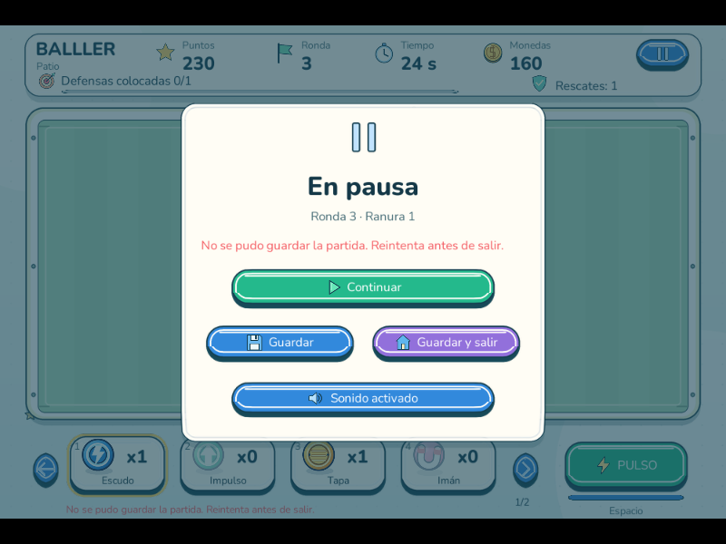
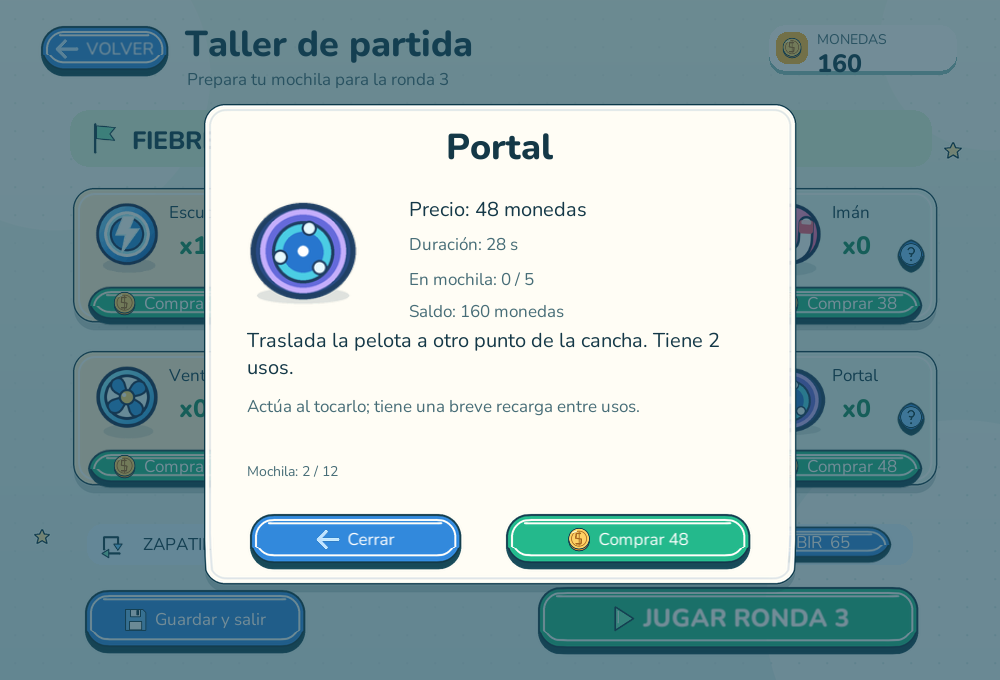
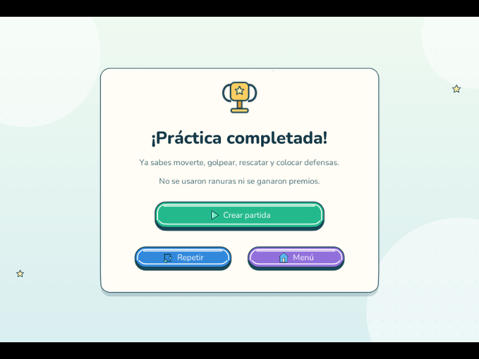

# Balller v8 — C2: pausa, guardado, ayudas y tutorial completo

Base: `8c2ee18d828505a26ae2bf97422b770772817b85` (C1). Rama `feature/v8-session-help-c2`, revisión dirigida a `feature/v8-run-flow-c1`.

## Implementado

| Flujo | Comportamiento |
|---|---|
| Guardar | La pausa permite guardar sin salir. El resultado se muestra; un error de ranura o perfil mantiene la sesión abierta. |
| Guardar y salir | Se vuelve al menú únicamente si se guardan la sesión, el progreso y los ajustes/récords. Si falla, se conserva la pantalla y el estado en memoria. |
| Autoguardado | Si falla durante una ronda, esta queda en pausa antes de avanzar pelota/cronómetro en ese paso. El jugador puede reintentar desde la pausa o continuar con el aviso visible. El perfil pendiente reintenta con espera, evitando escrituras fallidas cada frame. |
| Cerrar ventana | Se intenta guardar partida, perfil y ajustes/récords. Si falla, LÖVE cancela el cierre y ofrece Seguir aquí, Reintentar o Salir sin guardar. Solo la última opción explícita omite los cambios pendientes; no borra los archivos de partida. |
| Sonido en pausa | Interruptor para los efectos existentes. Si falla guardar ese ajuste, el valor vuelve al anterior y se informa. Música y buses nuevos siguen para G. |
| Ayudas de objetos | Botón de información en cada tarjeta del Taller. Ocho fichas con efecto, colocación, precio, saldo, duración y capacidad de mochila; compra desde la ficha con validación de fondos/capacidad. Enter no inicia la ronda detrás de una ficha abierta. |
| Tutorial | Cuatro pasos reales: mover, tocar, pulso y colocar defensa. Repetir/Omitir desde pausa; crear partida/repetir/menú al terminar. No utiliza ranuras ni suma estadísticas o gemas. Si falla guardar que se completó, se informa y se puede reintentar antes de salir. |

El pulso de práctica conserva la rapidez de 105 también al activarse, no solo tras la siguiente actualización. La física de las partidas normales y sus precios no se cambian.

## Arquitectura y compatibilidad

- `save.txt` no se reescribe cuando ya coincide con el estado actual, evitando errores y escrituras innecesarias sin cambios.
- `Game.saveSession()` coordina ranura, perfil pendiente y ajustes/récords; `saveError`/`saveNoticeT` son estados transitorios, sin cambiar el formato de guardado.
- `src/presentation/exit_flow.lua` representa el fallo de cierre y la decisión explícita de reintentar/cancelar/descartar cambios pendientes.
- `src/screens/session_help.lua` dibuja pausa, aviso de cierre, fichas y final de práctica con los PNG y fuente existentes.
- `data/object_help.lua` separa las explicaciones de las reglas de objetos. Los textos se contrastan con la lógica actual: Reloj afecta al ritmo de peligros; Impulso cambia dirección sin aumentar rapidez; Portal no promete una salida siempre segura.
- Formatos de ranura/perfil anteriores, sprites, dificultades y costes se conservan. Se siguen ejecutando sus regresiones.

## Pruebas realizadas

- Suites anteriores y `c2_saving.lua` / `c2_flow.lua` pasan.
- Errores simulados de escritura de ranura/perfil/ajustes; guardar/salir conserva la sesión, el cierre se cancela y solo descartar explícitamente lo permite sin guardar. Reintentar limpia el error al guardar correctamente.
- Fallo de autoguardado detiene posición/tiempo de ronda; las ayudas de las ocho defensas abren/cierran y permiten una compra válida, bloqueando falta de fondos.
- Tutorial completo mediante movimiento, colisión, pulso y colocación, con comparación de ranuras y estadísticas antes/después; fallo del indicador completado y reintento; controles Repetir/Omitir.
- Ayudas y controles a cinco resoluciones, parseo Lua y verificación PNG/fuentes.
- LÖVE 11.5 real en Linux/Mesa: se extiende el circuito C1 con un fallo de escritura simulado dentro del motor, cancelación del cierre, reintento de guardado, ayuda de objeto y práctica completa. Después repite y omite la práctica; las ranuras y el perfil conservan sus bytes. Los pasos de movimiento usan un delta fijo para que la comprobación no dependa de FPS del runner.
- 200 capturas nativas: 40 vistas × 5 tamaños. Incluyen pausa con error, fallo al cerrar, fichas de ayuda, taller con datos pendientes y fin/repetición de tutorial.
- `Balller-v8-C2.love`: ZIP validado y ejecutado en LÖVE. GitHub Actions repite pruebas/capturas y ejecuta el paquete.

```bash
lua tests/c2_saving.lua
lua tests/c2_flow.lua
love . --ci-flow
love . --visual-check
python3 tools/package_love.py --output Balller-v8-C2.love
love dist/Balller-v8-C2.love --ci-smoke
```

## Límites

Las escrituras siguen siendo directas con respaldo; no se certifican cortes de energía, cierre forzado del sistema ni transacciones atómicas entre archivos. Salir sin guardar descarta explícitamente los cambios que continúen pendientes en memoria. Una parte de los datos puede haberse guardado antes de fallar otra; no se anuncia deshacer todos los cambios. La fase D sigue pendiente para compras/recompensas y transacciones más robustas.

Cierra la implementación principal de la fase C. Falta la revisión de una persona nueva y las comprobaciones reales en Catalina/Windows, dentro de la validación final. La siguiente parte es D: economía configurable, compras/recompensas y persistencia del circuito de partida. No se publica un release final.

## Capturas reales






