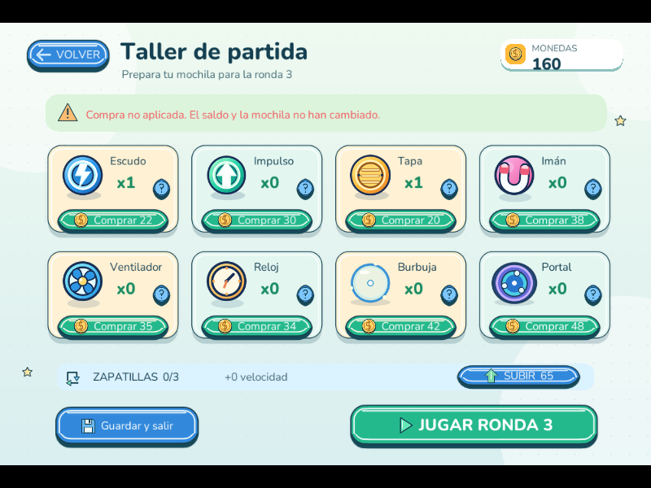
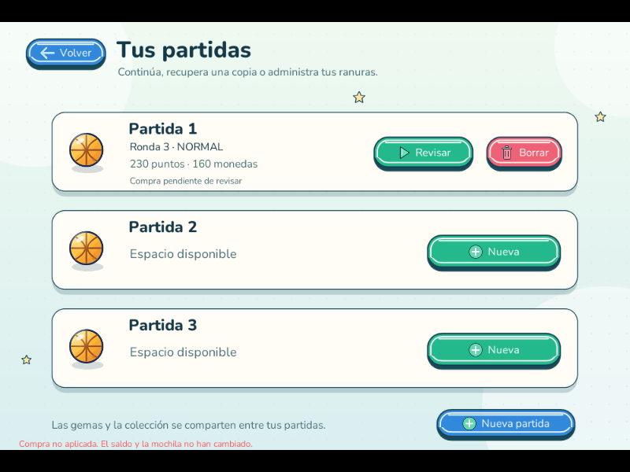
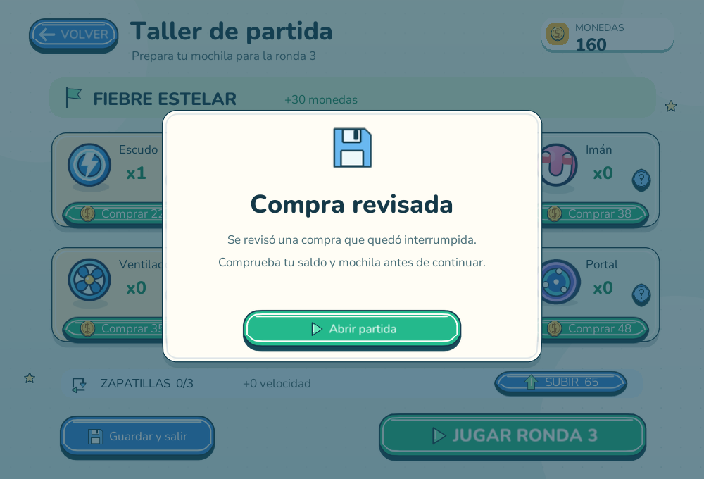
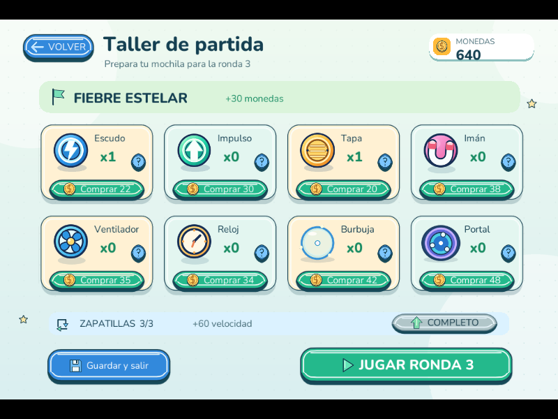

# Balller v8 — D1: configuración y compras recuperables

Base C2: `eb192822f7dced1039238812cbb6c8976c876529`. Rama `feature/v8-economy-d1`, revisión dirigida a `feature/v8-session-help-c2`.

## Implementado

`data/economy.lua` reúne los precios de ocho defensas, cuatro aspectos y tres mejoras, inventario inicial, límites y fórmula de recompensas. Se carga al iniciar; no es una configuración editable durante la partida. `src/economy/rules.lua` valida los límites compatibles con el formato anterior y comparte las reglas entre el Taller y las fichas de ayuda.

| Regla | Valor predeterminado |
|---|---|
| Monedas iniciales / máximo | 40 / 99999 |
| Unidades por defensa / mochila total | 5 / 12 |
| Defensas, en orden existente | 22, 30, 20, 38, 35, 34, 42, 48 monedas |
| Aspectos, en orden existente | 0, 4, 8, 12 gemas |
| Zapatillas, niveles 1–3 | 65, 120, 175 monedas; +20 de velocidad por nivel |
| Premio base / habilidad | 18 + 6 × ronda; 2 por golpe hasta 15 golpes |

Los valores anteriores se mantienen. Se corrige la expresión de máximo de zapatillas: el patrón Lua `a and nil or b` devolvía un precio incluso al alcanzar el límite; ahora el nivel 3 queda realmente completo. Un límite de monedas reducido en configuración no confisca saldos de partidas anteriores: deja de acreditar monedas mientras se supere ese límite.

## Protocolo de compra del Taller

1. Crear instantáneas independientes de antes y después, sin modificar el saldo visible.
2. Escribir y releer `partida_N.txt.purchase`, con cabecera versionada, número de ranura y estado anterior validado por el codec existente.
3. Guardar y verificar respaldo anterior y partida candidata.
4. Eliminar el registro pendiente y comprobar su ausencia: este es el punto de confirmación.
5. Aplicar saldo/inventario/zapatillas en memoria y emitir la respuesta de compra.

Si falla un paso, no se aplica la compra en memoria. La inspección de ranuras no escribe y muestra el estado anterior de un registro válido con la acción Revisar. Al cargar se restaura ese estado y se muestra Compra revisada. Una interrupción después del punto de confirmación conserva la compra, incluso si todavía no se había actualizado la pantalla. Un registro inválido o de otra ranura se conserva como diagnóstico antes de retirarlo; nunca se utiliza su carga para restaurar otra ranura.

El guardado normal resuelve primero cualquier compra pendiente; el borrado explícito de una ranura también retira su registro. Un error ajeno al guardar perfil/ajustes después de confirmar la compra se comunica como dato pendiente y no invita a cobrar la compra de nuevo.

## Compatibilidad y límites

No cambia el codec de partidas ni el formato del perfil. Continúan las fixtures v4–v7, las tres ranuras y las regresiones de física, direcciones y sprites. La copia `.bak` de una compra contiene el estado anterior por diseño.

El protocolo cubre errores de escritura/lectura/borrado e interrupciones del proceso simuladas; no certifica cortes eléctricos, durabilidad física del disco o atomicidad entre archivos. El registro debe permanecer íntegro para deshacer una compra pendiente. Los premios al terminar una ronda y el perfil compartido todavía no forman una única transacción: corresponden a D2. Las categorías, contenido adicional y balance extendido de la fase D siguen pendientes. Las simulaciones son referencias deterministas, no pruebas de diversión o partidas largas.

## Validación

- 23 suites Lua más el humo sin sprites; parseo de todos los archivos Lua y verificadores PNG/fuentes.
- `d1_rules.lua`: límites modificados, precios conectados, tres mejoras, cuatro simulaciones de diez rondas y 16800 combinaciones de recompensa iguales a la fórmula anterior.
- `d1_purchases.lua`: fallos en cada escritura y confirmación, registro parcial, relectura incorrecta, cierre antes/después de confirmar, perfil ajeno fallido, reinicio y registro de otra ranura.
- `d1_flow.lua`: compra desde ficha, recuperación visible, reintento sin doble cobro y controles escalados.
- LÖVE 11.5 real en Linux/Mesa: circuito C2 completo más fallo de confirmación, reapertura y reintento persistente con archivos reales.
- 220 capturas nativas: 44 vistas × cinco resoluciones. Cuatro vistas nuevas: compra fallida, pendiente, revisada y zapatillas completas.
- Paquete `Balller-v8-D1.love` verificado como ZIP, comparado con sus fuentes y ejecutado en el motor. CI repite pruebas, capturas y arranque del paquete.

```bash
lua tests/d1_rules.lua
lua tests/d1_purchases.lua
lua tests/d1_flow.lua
love . --ci-flow
love . --visual-check
python3 tools/package_love.py --output Balller-v8-D1.love
love dist/Balller-v8-D1.love --ci-smoke
```

## Capturas reales









D1 es una parte de D. A, B y C tienen su implementación principal en desarrollo (3 de 8 fases); quedan D2, E, F, G y H, incluida validación humana y Catalina/Windows. Esta entrega no fusiona las PR ni publica la versión final.
