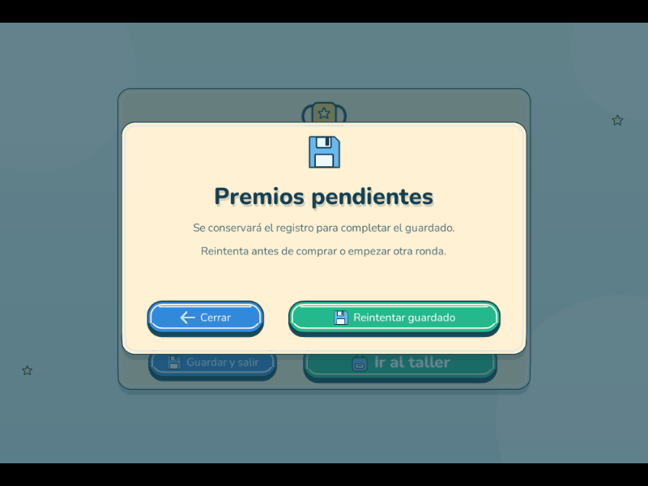
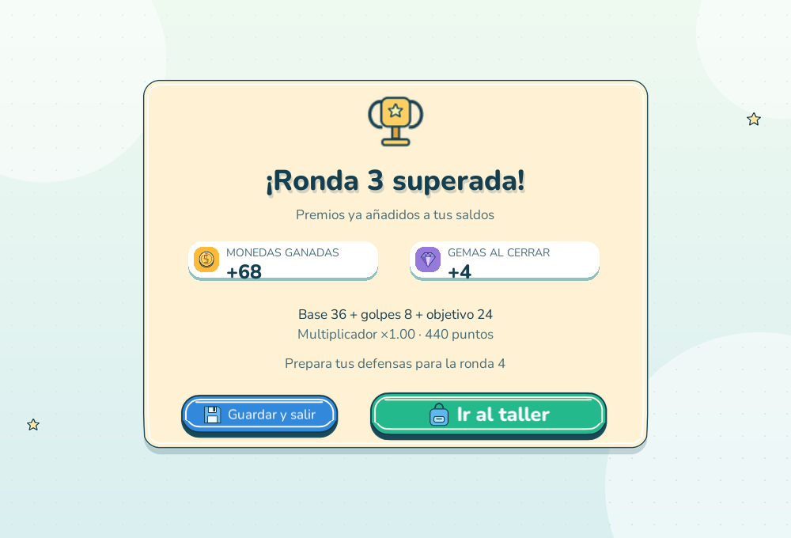
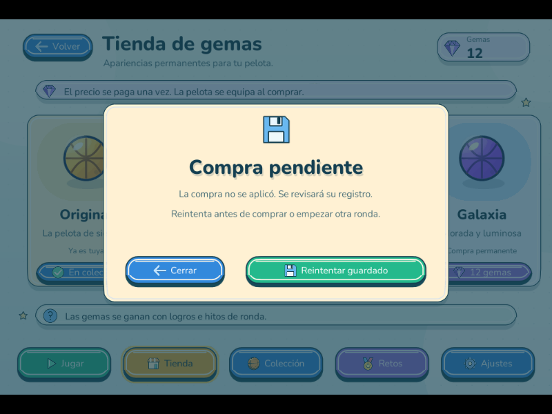

# Balller v8 — D2: premios coordinados y circuito de economía

Base D1: `8b613fda7a5ddc8fc5c46f8403ead77bc6abed59`. Rama `feature/v8-rewards-d2`, PR dirigida a `feature/v8-economy-d1`.

## Comportamiento

Al superar una ronda se construye el estado siguiente de la partida, el perfil y un recibo del premio. Antes de modificar esos archivos se escribe y relee un registro común `premios_balller_v8.pending`, con checksum y cargas validadas. La recuperación completa las mismas instantáneas: no vuelve a sumar monedas, estadísticas ni gemas. El registro se retira únicamente tras verificar los tres archivos.

Si falla una escritura, respaldo, relectura o borrado, los premios quedan pendientes y la interfaz bloquea compras, navegación y nuevas rondas. Reintentar continúa la operación. Al iniciar la aplicación se recupera antes de leer el perfil. Si falla preparar el registro, la sesión conserva la intención en memoria para reintentar; aún no hay garantía de recuperarla después de un cierre forzado. Un registro persistido inválido bloquea la continuación y conserva los bytes para revisión; no se elimina ni se interpreta como un premio nuevo.

El cierre normal intenta completar los premios. Si falla, mantiene el diálogo anterior de reintentar/seguir/salir explícitamente sin guardar. Esa última decisión puede perder cambios que solo existían en memoria; un registro válido ya persistido se completará en el siguiente inicio.

## Compras y resumen

- Las compras y el equipamiento de cosméticos usan `perfil_balller_v7.txt.purchase`: conservan el estado anterior hasta confirmar el archivo y retirar el registro. Un fallo mantiene saldo, propiedad y aspecto en memoria. Al reabrir se deshace la operación no confirmada; tras confirmar se conserva sin segundo cobro. Equipar sigue siendo gratis.
- Los registros incompletos de compras se archivan como `.damaged` antes de retirarlos; cada carga se valida con el codec del perfil. Los premios y las compras del Taller se bloquean mientras haya una compra de perfil pendiente.
- El recibo `partida_N.txt.reward` guarda gemas y desglose de base, golpes, objetivo y multiplicador. Se comprueba que coincida con la ranura y la última ronda/premio; los guardados anteriores sin recibo siguen mostrando el resumen básico. Su copia se borra al eliminar explícitamente la ranura.
- El Taller permite abrir «Ver premio» después de continuar. El resultado muestra las monedas realmente acreditadas y avisa si se aplicó el límite del saldo. Reabrir/cerrar el resumen no concede premios.

## Compatibilidad

`src/profilefile.lua` extrae el codec existente sin cambiar `BALLLER_PROFILE_1`. Las partidas siguen en `BALLLER_RUN_2`; los datos adicionales usan archivos auxiliares. Los precios y la física de D1 permanecen iguales. Se conservan las fixtures v4–v7 y los tests anteriores. El mock del test antiguo de progresión incorpora `filesystem.remove`, que ahora utiliza el protocolo; sus aserciones se mantienen.

## Validación

- 26 suites Lua, humo con/sin sprites, parseo de todos los Lua y verificadores PNG/fuentes.
- Fallos simulados en preparación, respaldo de partida/perfil/recibo, escritura, relectura y retirada del registro; reinicios después de escrituras parciales y justo antes/después de confirmar.
- Reintentos idempotentes, logros e hitos concedidos una vez, conservación del aspecto comprado, aislamiento de otra ranura y rechazo de registros inválidos.
- Circuito comprar → colocar → superar → guardar → menú → continuar durante 30 rondas en cada una de las cuatro dificultades: 120 rondas, sin cambios de saldo/gemas al recargar.
- UI de bloqueo/reintento y recibo persistente a cinco tamaños; recuperación también durante el inicio y al cerrar.
- LÖVE 11.5 real/Linux/Mesa: circuito C2/D1 ampliado con fallo de perfil al terminar ronda, cierre rechazado, reintento y lectura del recibo persistente.
- 235 capturas nativas: 47 vistas × cinco tamaños. Se añaden premios pendientes, desglose y compra de aspecto pendiente.
- `Balller-v8-D2.love`: ZIP comparado con las fuentes y arranque nativo. GitHub Actions repite suites, capturas y arranque del paquete.

```bash
lua tests/d2_rewards.lua
lua tests/d2_cosmetics.lua
lua tests/d2_flow.lua
love . --ci-flow
love . --visual-check
python3 tools/package_love.py --output Balller-v8-D2.love
love dist/Balller-v8-D2.love --ci-smoke
```

## Límites y siguiente fase

La recuperación usa escrituras verificadas con respaldo; no certifica cortes de energía, almacenamiento dañado, procesos simultáneos o abrir v7 mientras haya una operación v8 pendiente. La creación inicial y los ajustes/récords conservan su guardado anterior; este registro coordina el cierre de ronda, no todas las escrituras de la aplicación. Si un registro de premios está dañado, se necesita revisar sus archivos conservados antes de permitir nuevas operaciones. Las simulaciones no sustituyen balance con jugadores ni pruebas largas en Catalina/Windows.

La implementación principal de D queda completada en desarrollo junto con las tiendas y compras de B2/D1. A–D son 4 de 8 fases; no es un porcentaje de esfuerzo. Sigue E: Aprendiz con migración, capítulos y nuevas mecánicas. F/G/H continúan pendientes de su contenido y validación final. No se fusionan PR ni se publica un release final en esta entrega.

## Capturas del motor






