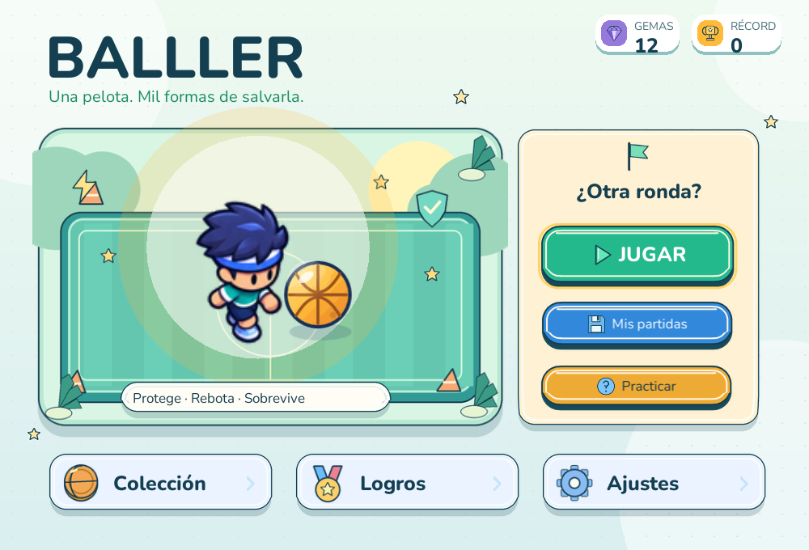
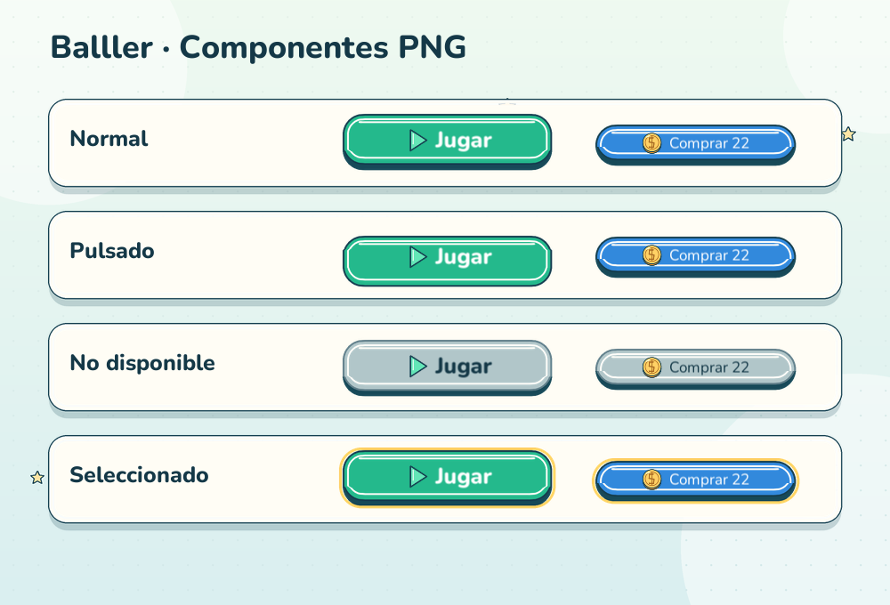
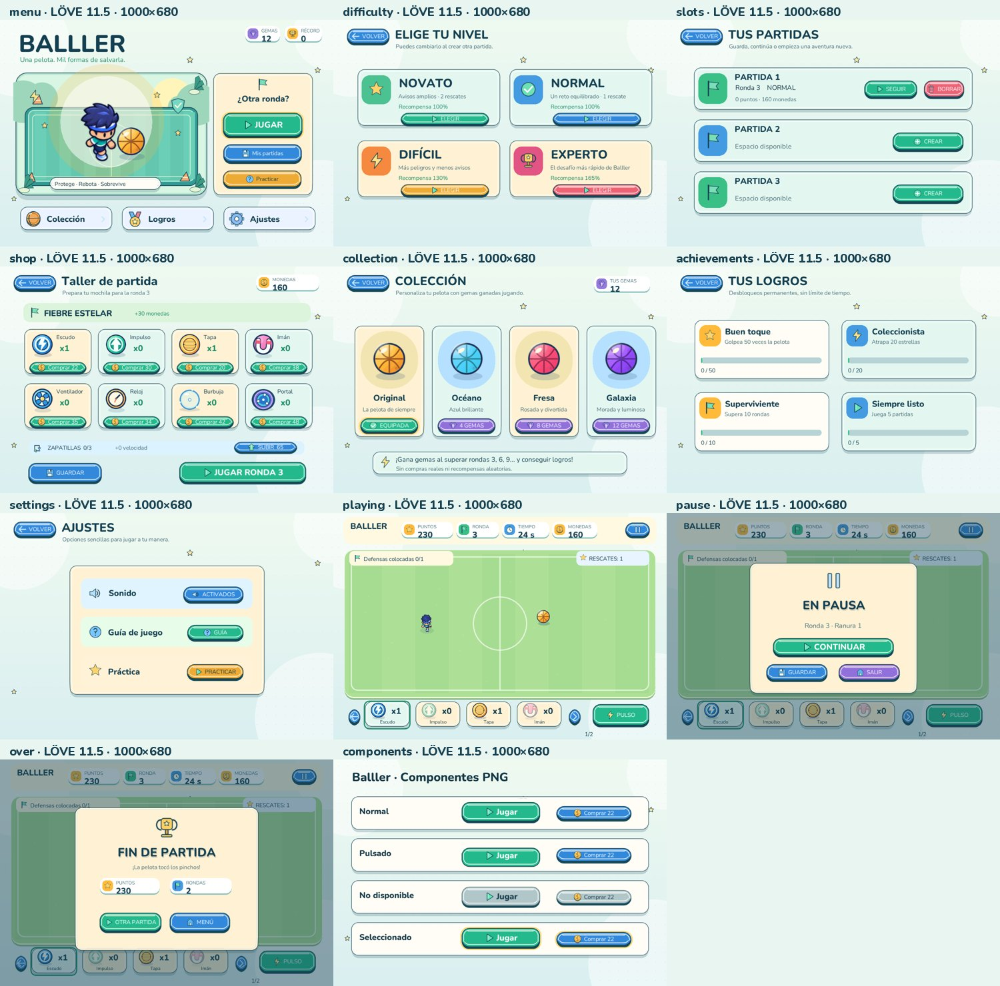

# Balller v8 — Guía visual, primera parte

Estado: lenguaje visual implementado sobre pantallas existentes. Las composiciones nuevas de tienda global, retos y resultados de ronda quedan para la siguiente parte de B; todavía no se da por terminada toda la fase.

## Dirección

Arcade deportivo luminoso: marfil y menta de fondo, tinta azul petróleo, superficies con relieve corto, botones anchos de contorno firme e iconos ilustrados. El personaje original y sus ocho direcciones siguen siendo la referencia. Ningún texto se rasteriza dentro de las imágenes: se conserva nitidez al escalar y permite traducción.

| Papel | Color base | Señal adicional |
|---|---|---|
| Jugar/confirmar | Menta #24B98C | Triángulo de reproducción o check |
| Navegación/guardar | Azul #3289DC | Flecha/disquete |
| Monedas/recompensa | Oro #EDAA34 | Moneda/trofeo; texto oscuro en botones dorados |
| Colección/gemas | Violeta #9270DB | Gema o candado |
| Peligro/eliminar | Coral #EE6276 | Advertencia/papelera |
| Texto/contorno | Azul petróleo #153F50 | Silueta de alto contraste |

Nunito Regular para instrucciones y etiquetas; ExtraBold para títulos y acciones. Se distribuyen instancias estáticas, con OFL y procedencia. El texto de botones se ajusta a una fuente menor cuando lo requiere el ancho; las acciones dominantes conservan cuerpo grande. Las compras tienen precio y moneda dentro de un botón de ancho completo para evitar miniacciones de texto.

## Componentes exportados

- Atlas de superficies: seis colores × cuatro estados, más cinco paneles.
- Columnas 0–5: menta, azul, oro, violeta, coral, marfil; filas 0–3: normal, pulsado, deshabilitado, destacado/equipado.
- Columna 6: cinco paneles; cada celda 128×128. Margen fijo de 24 px para nueve segmentos; centros y lados se estiran por separado, las esquinas conservan proporciones. Los componentes bajos reducen los extremos y omiten el centro cuando hace falta.
- Atlas de iconos: 8 columnas × 4 filas de 64×64; PNG individuales también incluidos. Solo se carga el atlas durante el juego.
- Fondo y cancha ilustrada separados del personaje animado.

El estado pulsado cambia relieve y desplazamiento; el deshabilitado es gris y bloquea la acción; el destacado tiene aro dorado. Un estado no se comunica únicamente por cambio de tono. El equipamiento mantiene texto explícito. Los iconos coloreados conservan contorno propio para funcionar sobre distintos fondos.

## Aplicación e incremento pendiente

Inicio, dificultad, ranuras, taller, colección, logros, ajustes, HUD, pausa y fin de partida comparten los nuevos recursos. El inicio usa la cancha PNG y el personaje animado original. Los botones de compras inválidas, mejoras agotadas y pulso en recarga muestran estado deshabilitado; las reglas de economía siguen residiendo en Game/Progression.

No se crean destinos sin función. La tienda global y los retos opcionales se diseñarán con su flujo definitivo; en esta entrega siguen existiendo colección y logros de v7. La cancha durante la ronda todavía usa el render histórico; las barras ilustradas, los fondos de capítulo y el resumen de recompensa están pendientes.

Referencias reales de la primera parte:

Son capturas del motor, con datos sintéticos de prueba, no maquetas de funciones futuras. Algunas estadísticas se fijan para revisar composición. No representan una partida completa ni certifican balance.

## Ampliación B2

Tienda de gemas y Colección ya son destinos distintos. Retos incorpora pestañas de Logros/Hitos con barras PNG, y cada victoria abre un resumen de premios ya recibidos antes del Taller. Las cinco secciones principales comparten navegación inferior. Ver [flujos, pruebas y capturas de B2](V8-FASE-B2.md). Las misiones nuevas y los capítulos siguen pendientes de sus fases funcionales.

## Ampliación B3

Patio, Taller y Ciudad ya tienen PNG de cancha y selección visual en Ajustes, conservando las dimensiones físicas. El HUD deja libre el área jugable y las instrucciones de práctica pasan a la cabecera. El modo reducido conserva las señales útiles de juego y suaviza efectos decorativos. Ver [implementación, pruebas y capturas B3](V8-FASE-B3.md). La asignación a capítulos se hará cuando exista ese sistema de juego.
